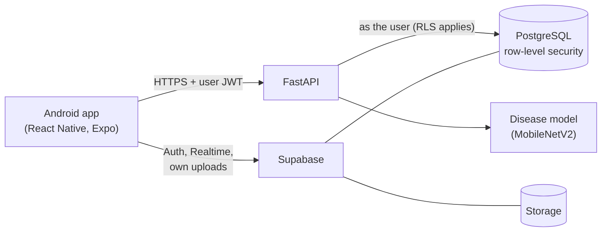

# ZaraiLink

**An agricultural marketplace and advisory app for Pakistan.** Farmers, buyers, input dealers, agricultural experts
and a platform administrator work in one Android app: farmers sell their produce, dealers sell seeds, fertiliser and
equipment and run their stock in a built-in inventory system, buyers order with cash on delivery, and a farmer can
photograph a sick leaf for an AI-assisted diagnosis that always hands over to a human expert.

[](https://github.com/TariqHussainChandio/ZaraiLink/actions/workflows/ci.yml)


> **Final-year project, not production-ready.** What works, and how it was proven, is recorded capability by
> capability in [`docs/status/feature-register.md`](docs/status/feature-register.md). Read it before relying on a
> feature.

## What it does

| Who | What they can do |
|---|---|
| **Anyone** | Browse the market without an account; open a listing and the seller's shop (their listings, rating and reviews) |
| **Buyer** | Cart and checkout with cash on delivery, order tracking, reviews, a wishlist, messages with sellers |
| **Farmer** | Sell produce, manage farms and crops, scan a sick leaf, ask a verified expert, sales analytics |
| **Dealer** | A marketplace shop with its own figures, plus a separate **inventory system**: products, stock by location, stock in and out, suppliers, purchases, low-stock alerts, reports and reconciliation |
| **Expert** | Apply with documents, be verified, answer farmers' consultations with an assessment kept apart from the AI's |
| **Admin** | Approve dealers and experts after reading their documents, moderate users, listings, orders, reviews and consultations; every action is audit-logged |

Rules the system enforces, not only the screens: dealer inventory is visible to its dealer alone; delivery is its own
line on every order; ZaraiLink never holds money (buyers pay sellers directly); AI results are advice that route to an
expert; only farmers open consultations; every admin action leaves an audit row.

## How it is built

| Layer | Technology |
|---|---|
| Mobile app | React Native 0.86 with Expo SDK 57, TypeScript, React Navigation 7, TanStack Query, Zustand, react-hook-form + zod |
| API | FastAPI on Python 3.12, managed with uv |
| Data and auth | Supabase: PostgreSQL with row-level security, Auth (email codes), Storage, Realtime |
| AI | MobileNetV2 plant-disease classifier (38 classes, PyTorch on CPU) served by the API |



The API calls the database with the signed-in user's own token, so row-level security decides what each person can
read and write; the API adds the business checks (roles, approval, idempotency) on top. The database schema, every
policy and every function are documented in [`docs/database/schema.md`](docs/database/schema.md).

## Repository layout

```
frontend/   React Native app: one folder per module (admin, farmer, dealer, buyer, expert, ai, inventory,
            common/<feature>) plus shared theme, navigation, services, state, hooks, utils
backend/    FastAPI service: the same modules (router, service, repository, schemas) and their tests
supabase/   Migrations, pgTAP database tests, reference seed data, local stack config
scripts/    Quality gates (check_reality.py, migration and advisor checks) and CI helpers
docs/       Requirements (SRDS), plan, architecture, database, setup, process and status
```

## Run it locally

You need Node 22+, Python 3.12, [uv](https://docs.astral.sh/uv/), Docker Desktop, and Android Studio with an
emulator or a phone. The full guide, including the phone-over-USB setup, is
[`docs/setup/DEVELOPMENT_SETUP.md`](docs/setup/DEVELOPMENT_SETUP.md).

```bash
# 1. App dependencies
npm ci

# 2. Local Supabase in Docker (applies every migration)
npx supabase gen signing-key --algorithm ES256 --workdir "$(mktemp -d)" \
  | python -c "import json, sys; json.dump([json.load(sys.stdin)], sys.stdout)" > supabase/signing_keys.json  # once per clone
npx supabase start
npx supabase status -o env            # the local URL and keys for the next steps

# 3. API (run it from backend/, so it reads backend/.env)
cd backend
uv sync --frozen
cp .env.example .env                  # fill in the local values from step 2
python ../scripts/fetch_model_weights.py   # the model is kept in Supabase Storage, not in git
uv run uvicorn app.main:app --reload --host 0.0.0.0 --port 8000
cd ..

# 4. App: copy .env.example to .env and fill the EXPO_PUBLIC_ values (the emulator reaches the API at 10.0.2.2)
npm run android                       # first run builds and installs the development app
npm start                             # later runs: start Metro and open the installed app
```

`android/` is generated from `app.config.ts` and is not checked in. Data and files live in Supabase, never in git:
no model weights, datasets, exports or uploads are committed.

## Quality checks

```bash
npm run lint && npm run typecheck && npm test   # app: ESLint, TypeScript, Jest
cd backend && uv run pytest                     # API: unit tests, and real-stack tests when the local stack runs
npx supabase test db                            # database: every policy and grant, exercised as real users
python scripts/check_reality.py                 # no stubs, fake behaviour, or growing debt
```

Every pull request runs all of these in CI, along with an Android build, secret scanning (gitleaks), dependency
scanning (osv-scanner) and static analysis (Semgrep). `main` only changes through a pull request whose checks pass.

## Security

- Row-level security on every table, with tests that prove each policy as two different users: the allowed path and
  the refused one.
- GitHub secret scanning with push protection, CodeQL code scanning, Dependabot alerts and security updates.
- CI actions pinned to exact commits; workflows get read-only tokens by default.
- Secrets live in GitHub and Supabase secret stores or a local `.env` that git ignores, never in the code.

Found a vulnerability? Please report it privately through the **Security** tab, as described in
[`SECURITY.md`](SECURITY.md).

## Documentation

| | |
|---|---|
| [`docs/CODE-MAP.md`](docs/CODE-MAP.md) | Where each feature lives: screen, backend route, tables, business rules |
| [`docs/srds.md`](docs/srds.md) | Requirements baseline: roles, approval, inventory boundary, AI |
| [`docs/plan.md`](docs/plan.md) | The phased plan and every design decision |
| [`docs/status/`](docs/status/) | What works today, and how it was verified |
| [`docs/architecture/`](docs/architecture/) | Authorization, backend, notifications, AI advisory |
| [`CONTRIBUTING.md`](CONTRIBUTING.md) | How to contribute |
| [`AGENTS.md`](AGENTS.md) | Rules for AI coding agents working in this repository |

## Licence

Apache License 2.0. See [`LICENSE`](LICENSE).
